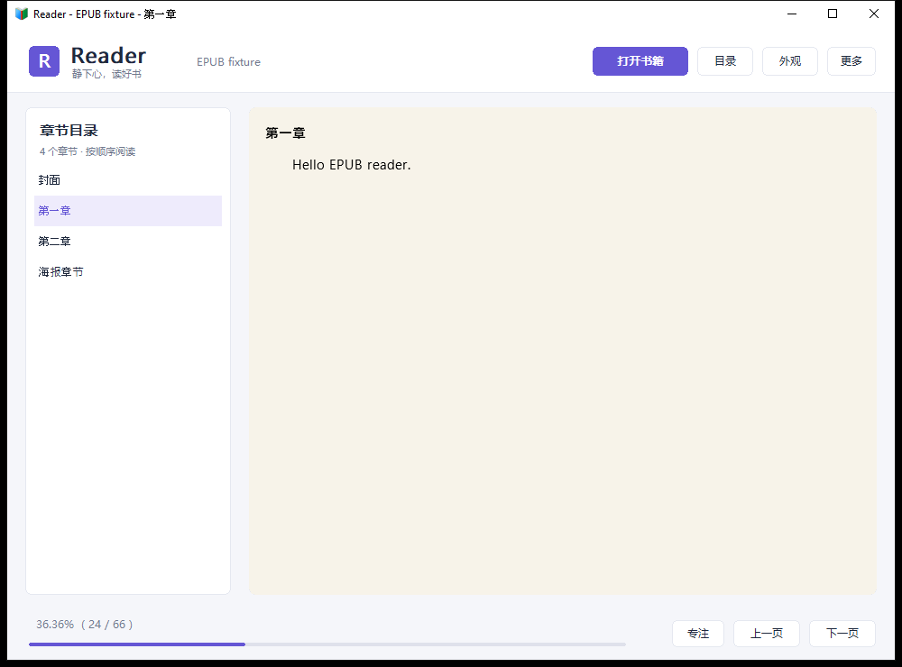
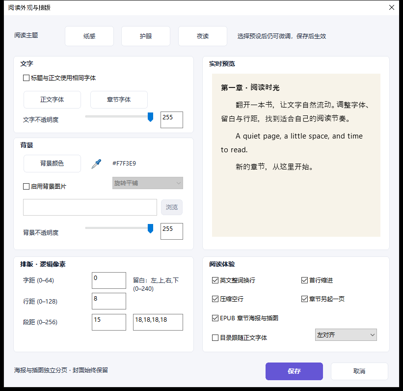
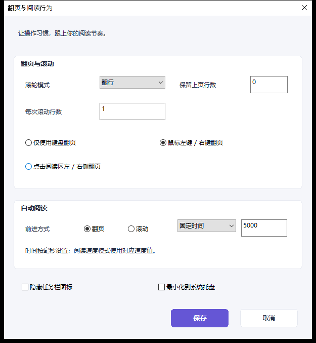
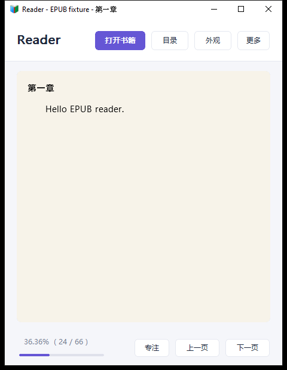

# Reader 现代界面重设计

采用浅灰背景、白色分组卡片与紫色强调色，重新组织主界面和常用设置。
书籍的纸感、护眼、夜读及自定义字体／背景仍作用于阅读区域。

## 阅读空间

顶部工具栏集中打开书籍、目录、外观与更多操作。宽窗口以固定侧栏展示目录；
窄窗口自动收起侧栏，点击目录可覆盖显示。章节选择和阅读进度同步更新。
底部提供进度条、专注模式和上一页／下一页。

## 首页

## 外观与阅读行为

共享弹窗配色、分组卡片、圆角按钮、悬停与焦点反馈；统一默认界面字体。
外观页保留主题预设和真实排版预览，阅读行为页重新整理滚动、翻页与自动阅读选项。
原生复选框、输入框和下拉框保留其标准操作。

## 窄窗口

## 操作与验证

- Tab / Shift+Tab 在工具栏、目录、底部操作与阅读区之间移动；Enter 激活按钮。
- 工具栏获得焦点后，阅读方向键和全局快捷键仍可使用；Space 保留按钮激活行为。
- 阅读区焦点下保持原有快捷键，F12 切换无边框专注模式，F11 切换全屏。
- Windows x64 构建和实际窗口截图检查覆盖 EPUB 打开／翻页、两类设置打开／取消、
  Tab / Enter、工具栏焦点下方向键、窄窗口目录、专注模式恢复与实际进度条比例。
- 本地 EPUB 解析、32 组集成排版、21 份图片解码和 400 组图片适配检查继续通过。

这些截图来自 Windows 原生程序，不是设计稿。当前截图环境为 Windows Server 2022
默认 DPI；其他 Windows 版本、高 DPI、多显示器和辅助技术仍需要进一步实测。
该实现位于 `ui/modern-redesign` 分支，供开发预览使用。

最终代码验证提交：`d1ce6c4af2ab7a98300ba49f6c147a6ec1bb3321`。
[Windows 构建与交互验证记录](https://github.com/Fangcbb/Reader/actions/runs/41590489364)
已通过；测试包 SHA-256 校验通过。

[下载现代 UI Windows x64 测试包](https://github.com/Fangcbb/Reader/actions/runs/41590489364/artifacts/13210041973)
（GitHub Actions 产物下载需要登录）。测试包沿用基础文件版本 3.2.0.0，
以此分支和构建记录识别；它与之前发布的首个预览 Release 内容不同。

## 后续更新：全屏取色与独立明暗 UI

右上角现有明暗切换图标，界面颜色设置独立于阅读配色。
[使用说明、验证结果与最新测试包](screen-picker-and-ui-theme.md)。

## 阅读场景预设

支持命名保存字体、颜色、背景与排版并整体切换。
[预设使用说明、当前测试包与升级路线](reading-presets-and-roadmap.md)。
