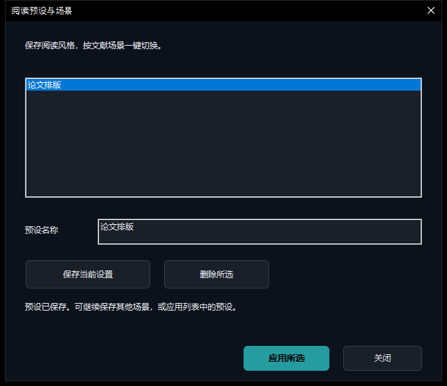

# 阅读预设与后续升级

## 本轮实现：场景化阅读预设

入口：**更多 → 阅读预设与场景**，也可从外观窗口顶部的「阅读预设」进入。

1. 先设置适合当前文献的正文／章节字体、字号、文字颜色、背景和排版。
2. 打开预设窗口，输入名称，例如「论文精读」「小说夜读」「英文长文」，点击「保存当前设置」。
3. 以后选中预设并点击「应用所选」，或直接双击名称，即可整体切换。

从主界面应用时即时生效；在外观窗口中应用时先预览，再点击外观窗口「保存」。
支持确认覆盖同名预设及删除预设；保存／删除是明确的持久化操作，关闭管理窗口不会撤销。

包含正文／章节字体及字号、颜色、字体统一选项、背景色／图片／图片模式、窗口／文字透明度、
留白、字距／行距／段距、缩进、英文换行、章节分页、对齐和 EPUB 图片显示选项。

字体按逻辑尺寸保存；跨 DPI 应用时重新转换。背景图片不存在时会提示是否临时使用纯色。
最多 64 个预设，每个名称最多 64 字符。软件 UI 明暗主题不属于阅读预设，不会被覆盖。

## 验证与测试包

[Windows x64 测试包](https://github.com/Fangcbb/Reader/actions/runs/41612155239/artifacts/13219377832)（下载需要登录 GitHub）。
这是开发分支的测试构建，未发布新的 Release。

[Windows 验证记录](https://github.com/Fangcbb/Reader/actions/runs/41612155239)：原生 Release x64 编译、
EPUB 阅读与图片、主界面操作、全屏吸管、独立 UI 主题测试通过。
预设测试通过实际窗口保存配置，重启后先改变活动字号、文字颜色、背景和行距，再应用已保存预设，
确认这些参数恢复且软件 UI 主题不变。

## 后续升级优先级

下面是建议与后续工作范围，**尚未全部实现**。采用阅读器常见的场景化与低干扰设计原则，
优先完成可靠的数据和切换体验，再扩展功能。

| 优先级 | 改进 | 用户收益 |
| --- | --- | --- |
| P1 | 单书绑定预设、打开文献自动恢复，预设失效时安全回退 | 不同文献无需反复手动切换 |
| P1 | 预设导入／导出、版本兼容与重名处理 | 换电脑时保留个性化配置 |
| P1 | 书架封面、最近阅读、进度与置顶 | 更快找到正在读的文献 |
| P1 | 搜索结果上下文与回到原阅读位置 | 查资料后不丢失阅读位置 |
| P2 | 稳定的 EPUB 章节定位／书签迁移 | 升级解析器后尽量保持定位 |
| P2 | 批注、书签整理和 Markdown 导出 | 支持学习与文献精读 |
| P2 | 完整字素簇／复杂文字塑形、图片说明与更丰富图文排版 | 改善中英文混排及专业文献体验 |
| P2 | 高 DPI／多屏、键盘与辅助技术专项验收 | 提升不同设备下的可靠性 |

这批工作不将软件 UI 主题与书页配色绑定，避免切换软件明暗时意外改变阅读样式。
