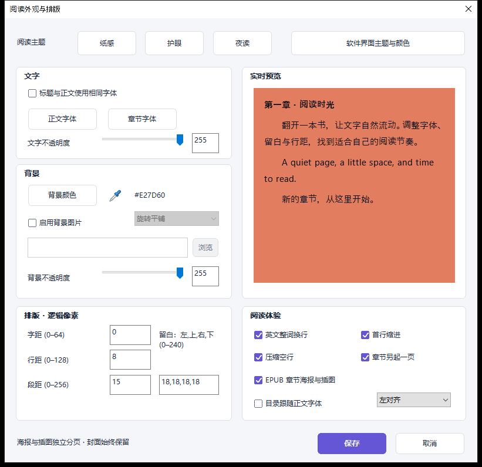
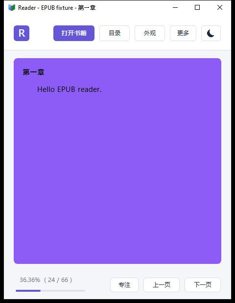
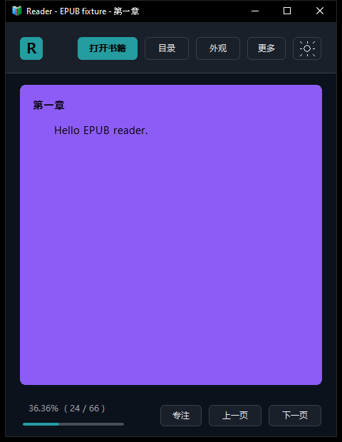
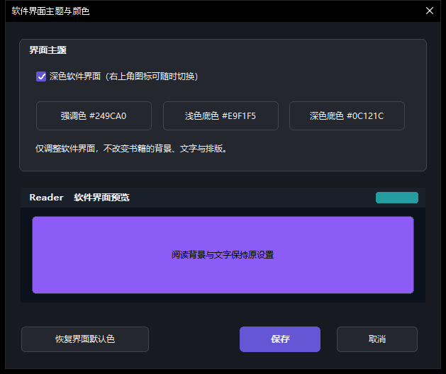

# 全屏吸管与独立软件界面主题

## 全屏取色

在「外观」中使用背景颜色旁的吸管：

- 点击吸管后，可移动到桌面或其他软件窗口，再点击确认。
- 也可按住吸管拖到屏幕上的目标位置，松开确认。
- Esc 或右键撤销本次取色，恢复开始前的颜色。
- 松开确认后停止采样；保存外观设置才应用所选阅读背景。

采样采用屏幕物理坐标，不再将窗口外的负客户区坐标当成无符号数。
鼠标捕获丢失、取消操作和关闭设置都会清理取色状态。

## 软件界面的明暗切换

右上角新增月亮／太阳图标，直接切换软件 UI 的浅色与深色模式，并记住选择。

自定义入口：**外观 → 软件界面主题与颜色**，或 **更多 → 软件界面主题与颜色**。
可分别选择强调色、浅色底色、深色底色；文字、面板和分隔线会自动生成适合的配色。
设置提供预览、保存、取消及恢复界面默认色。

该配置单独保存在 `uiTheme` 中。工具栏、侧栏、菜单、按钮和设置窗口随界面主题变化，
阅读背景、阅读文字和排版不随之改变。截图中的紫色书页是吸管验证时主动选定的测试色，
不是切换软件明暗模式产生的背景。

## 验证

Windows x64 原生程序已通过：

- 从独立 PowerShell 进程窗口取指定 RGB 色；覆盖设置窗口左上方的负客户区坐标和屏幕右下方。
- 拖动取色、点击后选色、停止采样、Esc／右键／捕获丢失撤销、关闭清理和保存后重启。
- 软件明暗切换、自定义三种 UI 颜色、取消不保存、保存后重启恢复。
- 保存前后阅读背景、文字样式及排版 JSON 保持一致。
- 浅色、深色、自定义界面色及重启后的阅读区截图像素保持一致。
- 深色复选框和单选框的文字／勾选状态可读，保留原生控件交互。

本地另有 250 组自定义配色对比度检查，以及原有 EPUB 和图片回归检查通过。
CI 未模拟实机多显示器／不同 DPI；这些组合仍需在相应设备补充验证。

验证代码提交：`db905e5021160df2e68b97b265a6e55d8ae6170a`。
[Windows 构建与验证记录](https://github.com/Fangcbb/Reader/actions/runs/41607752821)

[新版 Windows x64 开发测试包](https://github.com/Fangcbb/Reader/actions/runs/41607752821/artifacts/13217292983)
（Actions 产物下载需要登录 GitHub）。请使用此链接替代旧 UI 测试包。
EXE/ZIP 的 SHA-256 校验通过；基础文件版本仍为 3.2.0.0，以分支和构建记录区分开发构建。
